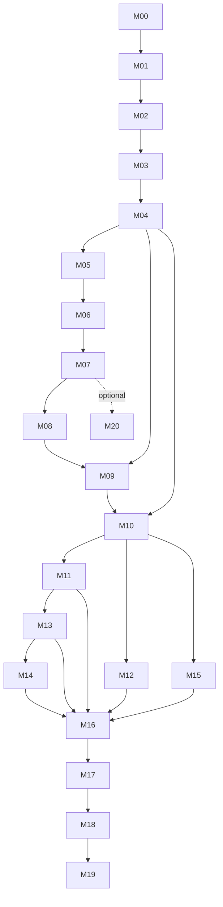

# Complete milestone plan

All original milestone work, dependencies, deliverables and acceptance text below are retained from the user-adopted brief. The explicitly dated launcher amendment extends them without changing the preserved source brief. This is the execution backlog, not achieved functionality. Status vocabulary: TODO, IN_PROGRESS, IMPLEMENTED_NOT_RUN, VERIFIED, BLOCKED. Native completion requires original-game evidence.

This table tracks the development milestones. **The code in this public clone remains at the reviewed M08 export.** The [development update](evidence/2026-09-27-development-update/SESSION.md) distinguishes later native acceptance from published source availability.

| ID | Objective | Status |
|---|---|---|
| M00 | Establish the project contract and actionable backlog | VERIFIED |
| M01 | Reproducible build, compatibility guard, and save protection | VERIFIED |
| M02 | Native-behavior baseline and engine observability | VERIFIED |
| M03 | Multiple actors using original gameplay functions | VERIFIED |
| M04 | Unattended original-game worker and isolation | VERIFIED |
| M05 | Separate authoritative simulation from replica presentation | VERIFIED |
| M06 | Real network session and authoritative scene replication | VERIFIED |
| M07 | First complete native shared encounter | VERIFIED |
| M08 | Native content, terrain, and editor-commit foundation | VERIFIED |
| M09 | Durable checkpoints, reconnects, and crash recovery | VERIFIED |
| M10 | One universe across multiple native locations | VERIFIED |
| M11 | Creature stage gameplay coverage | IN_PROGRESS |
| M12 | Cell stage gameplay coverage | TODO |
| M13 | Tribal stage gameplay coverage | BLOCKED |
| M14 | Civilization stage gameplay coverage | BLOCKED |
| M15 | Space stage and persistent galaxy gameplay | BLOCKED |
| M16 | Mixed stages and cross-location consequences | BLOCKED |
| M17 | Native editors and the full Cell-to-Space campaign | BLOCKED |
| M18 | Usable hosting, Internet operation, security, and capacity | BLOCKED |
| M19 | Release qualification and complete deliverables | BLOCKED |
| M20 | Optional extension: Galactic Adventures multiplayer | TODO |

M00/M01 session detail: `evidence/2026-09-08-m00-m01/SESSION.md`. M02 observation increment: `evidence/2026-09-08-m02-observation/SESSION.md` (BUILD/HOST/FIXTURE only; native tests NOT RUN). M02 native completion: `evidence/2026-09-09-m02-completion/SESSION.md`. M03 implementation: `evidence/2026-09-09-m03-actors/SESSION.md`. M04 supervision implementation: `evidence/2026-09-12-m04-workers/SESSION.md`; current-desktop native actions, concurrency and checkpoint boundary: `evidence/2026-09-13-m04-native/SESSION.md` (historical increment); M04 completion: `evidence/2026-09-13-m04-acceptance/SESSION.md` (VERIFIED for the recorded fixture). M05 initial vitals projection: `evidence/2026-09-13-m05-replicas/SESSION.md`; native reward replay and mutation guards: `evidence/2026-09-13-m05-completion/SESSION.md` (historical increment); M05 completion: `evidence/2026-09-14-m05-ability/acceptance.md` (VERIFIED for the recorded living Creature fixture). M06 completion: `evidence/2026-09-14-m06-network/acceptance.md` (VERIFIED for the recorded living Creature fixture). M07 completion: `evidence/2026-09-21-m07-completion/acceptance.md` (VERIFIED for the recorded shared Creature fixture). M08 completion: `evidence/2026-09-22-m08-completion/SESSION.md` (VERIFIED for the recorded Creature content/editor foundation). M09 completion: `evidence/2026-09-22-m09-persistence/acceptance.md` (VERIFIED for the recorded Creature checkpoint foundation). M10 completion: `evidence/2026-09-26-m10-native-state/NATIVE-RECOVERY-086.md` (VERIFIED for the recorded native Creature location foundation). M11–M20 remain unverified. No stage scope is deferred to optional M20.

M03–M09 are verified for their recorded native Creature foundations. M10 is VERIFIED within its recorded native boundaries. M11 is IN_PROGRESS with bounded social rewards/persistence, one normal-control social exchange, A's starvation/revival and pending-death reconnect, and preservation of B's native progress after combat death in 0.0.106–0.0.114. Later .118-0.0.126 increments add normal social cancellation; original B hunger/starvation; normal B Bite with its native reward; and exact fresh-load progression/corpse state with both clients controllable. Later .129-.139 increments qualify normal B corpse-click feeding/save/restore, both players camera-relative movement and releases, normal A Bite/reward/Save, and A melee-death owner presentation/original revival with B continuation. Fresh reload of A's trial71 combat reward and Save after trial72 melee revival remain unqualified. Trials118-119/.167 subsequently qualify two B melee respawns in one authority process, Save and fresh restoration. Remaining death causes/species, broader distinct-species relationships, independent objectives and every full C01-C12 acceptance gate remain open. M12 is TODO with foundation dependencies satisfied; M13–M19 retain unfinished stage/faction dependencies. Every original work/deliverable/acceptance clause remains intact. Full Creature progression remains M11. Current M03 evidence: `evidence/2026-09-12-m03-awards/SESSION.md`; M04: `evidence/2026-09-13-m04-acceptance/SESSION.md`; M05: `evidence/2026-09-14-m05-ability/acceptance.md`; M06: `evidence/2026-09-14-m06-network/acceptance.md`; M07: `evidence/2026-09-21-m07-completion/acceptance.md`.

M11 follow-up through .181: trials146/147 qualify a subsequent original A kill
and Save/fresh shared-scene restoration of A14/B7 DNA and 679 exact player/
inventory rows. A's normal jump lands; original collections remain distinct.
B's objective panel still mirrors A's hunt. Complete primary history retention
is unqualified: the extension-write diagnostic and reload census differ.
Both runs close cleanly and restore their profiles. No complete gate closes.

Retained M11 follow-up through .180: trials143/145 add normal A corpse feeding and
original Save/fresh shared-scene restoration of both owners' 7 DNA/progression,
A's recovered health and all 679 player/inventory rows. No reward is replayed.
A's normal jump lands and B diagnostically steers/releases after reload.
Trial144's exhausted-corpse validation failure is retained and corrected.
Broader diets, foreign B feeding, A live new-history delivery and physical
held input remain unfinished. All twelve complete M11 gates remain OPEN.

Retained M11 follow-up through .179: trial141 adds A's native first kill, 7 DNA and
completed owner First DNA while distinct-species B moves and preserves its
7 DNA/history. A's authority history grows 2 to 3; its new client history and
new-result Save/reload remain unfinished. Six clean exits and restored profiles
pass. Diagnostic inputs do not qualify full normal play or later progression.
All twelve complete M11 gates remain OPEN.

M11 follow-up through .178: trial137 qualifies repeated diagnostic steering
and native release for A and distinct-species B, with correct visible owner
views, retained DNA, six clean exits and restored profiles. Physical held-key
acceptance remains NOT RUN; no native movement correction is claimed. Trial136
retains a display interruption, A projection failure and forced B exit35.
All twelve complete M11 gates remain OPEN.

Retained M11 follow-up through .177: trials130/134 qualify explicit original Save and
fresh authority/two-client restoration of the pinned distinct-species first-kill
result. All 679 player/inventory rows match; B retains 7 DNA and its private
relationship/history. Both clients adopt their saved actors and show their own
Sporepedia collection. A's normal jump lands and B moves diagnostically after
reload. Trials131–133 retain their failed client baselines. Broader campaign
progression, sustained ordinary B movement, coordinator publication/crash tests
for this format and all twelve complete M11 gates remain OPEN.

Retained .176 result: trial129 qualifies B's original first-kill history
in its own Sporepedia Creature Game collection, with A's collection unchanged
and correct reopening. After corpse retirement, A's normal jump lands and B
moves through a diagnostic command; both remain alive through clean closure.
The separate evolution timeline, foreign Save and full independent progression
remain open. All twelve complete M11 acceptance gates remain OPEN.

Retained .174–.175 result: trial127 qualifies one original foreign B
kill from a diagnostic intention, 7 DNA/goal/combat progress, private authority
history (category 8, event 5, relationship 1) and owner First DNA completion,
with A's progression/relationship/history unchanged. Its later corpse-pool
retirement incorrectly fences commands. Trial128/.175 verifies completed
corpse retirement with both owners' results preserved and no failure fence.
A later dies through original saved starvation while B remains alive.
Post-retirement controls are NOT RUN: automatic closure under the 210-second
run limit preceded the attempted input. The brief normal B W pulse in127 reached
WalkTo/StopMovement without material displacement. Client history UI, foreign
Save, sustained ordinary B movement and broader independent progression remain
unqualified. Each run closes with six zero process exits and all three profiles
restored; all twelve complete gates remain OPEN. The earlier .173/trial126
preflight refusals remain retained evidence.

Retained .172 result: trial125 adds B's correct original avatar portrait
at initial and fresh connection, diagnostic movement after reconnect and a
normal input that retains the original zero-capability jump refusal. A's
normal jump lands during the gap and it remains alive through clean closure.
History contents, normal B keyboard movement, complete UI, independent
foreign gameplay/progression and persistence remain unqualified.

Retained .171 foundation: trials123-124 add distinct-species original
client avatars, diagnostic B movement and a fresh-process reconnect that
preserves its entity, species and moved position. The portrait/history
still showed A; normal B movement, controls after reconnect, independent
foreign gameplay/progression and persistence were unqualified in those runs. No Save
was requested in these foreign trials. Every complete C01-C12 gate stays open.

Retained follow-up through .167: trials88-89 qualify B's original part card, live
owner inventory, owner tutorial and exact fresh restoration. Trials94-95 add
B's original home/nest replication, Save and fresh restoration. Trial98 adds
B's original starvation handler, owner confirmation, revival and Save with
peer continuation, but left B as a hatchling. Trials112-113 now qualify the
owner-controlled original lesson, adult growth, normal jumps, Save and fresh
restoration of B's adult state and the recorded player/inventory census.
Learned-ability bits and complete native Stage state are outside that census.
Trials115-116 add one original melee respawn from a restored populated herd,
preserving its two members, Save and exact fresh restoration. Combat setup is
diagnostic; owner confirmation and jump controls are normal. Trials118-119
then qualify two complete cycles in one authority process, Save and fresh
restoration. Remaining causes/species and all twelve C01-C12 gates stay open; see
`docs/m11-work-audit.md` for the current implementation and native boundary.

## Required launcher amendment — 2026-09-08

The user requested a launcher, then required a much stronger visual design and maximum automatic setup. Deliver one Windows desktop application, extended alongside the relevant milestones; the final product must not depend on users assembling command lines or manually running a diagnostic checklist. See `docs/launcher.md` for implementation and evidence.

| Milestone | Additional launcher work and acceptance |
|---|---|
| M01 | Build a polished desktop executable with one clear primary action. Automatically detect installed copies through OS/store records and Steam libraries, check executable/content/prerequisites, create or reuse a verified personal file backup and prepare reusable working folders. Prompt only for missing/ambiguous installation choices or actionable errors. Keep paths, technical checks and local report export in Settings. Distinguish a directory workspace from OS isolation. The guarded native start path must refuse mismatches before injection. Test automatic cold/warm startup, the actual window and failure paths, as well as three isolated native lifecycles for overall M01 acceptance. |
| M04 | Add isolated worker selection and start/stop/status backed by the real supervisor; surface readiness, crash and desktop requirements. |
| M06 | Add server address/invitation, authenticated join, content/build denial and connection status backed by a real session. |
| M09 | Add rejoin and recovery status backed by authoritative restore; retain protected backup locations. |
| M18 | Complete host configuration, dedicated server controls, invitations, player management, support export and actionable Internet errors in this same launcher. Validate on a second machine. |
| M19 | Package and document the launcher, supported prerequisites, install/uninstall and recovery. A new user must host, join and resume through the shipped UI without developer intervention. |

No speculative server list, mock online players or enabled future-only buttons count as a deliverable. The launcher is required; Galactic Adventures remains optional M20, and every original M00–M20 acceptance section below remains in force.

Player-flow correction (2026-09-08): the user rejected mandatory separate profiles and personal-save gates. The M01 player launcher uses the normal Windows account and existing saves through Play SPORE. Compatibility checks run automatically; diagnostic details stay in Settings. Earlier isolated runs remain developer evidence, and optional backup/isolation tools remain available for future multi-process investigations. This explicit amendment overrides the earlier player backup/profile requirements; the original M00–M20 sections remain preserved below.

M01 accepted 2026-09-08: completed native bridge cycles and mismatch checks, plus user confirmation of the normal-account launcher. The user requested no further repeated tests. Evidence: evidence/2026-09-08-m01-native/SESSION.md. M02 is next; later acceptance remains unexecuted.

## Dependency graph

The graph shows major gating paths; the exact dependency text below is authoritative, including infrastructure work that can start earlier. M03 multi-actor gameplay and M04 isolation are explicit native gates. M18 hardening begins in M01; eight-client capacity remains an experiment.

### M00 — Establish the project contract and actionable backlog

**Dependencies:** none.

**Work:** Inspect the repository, toolchain, installed SDK/game, and available testing machines. Record existing code before changing it. Create GOAL.md, AGENTS.md, the full milestone checklist, and a concise STATUS.md. Write initial authority and architecture decisions from this brief. Separate native behavior, new multiplayer policy, and unknown engine capabilities. Map every required feature to an eventual acceptance test.

**Deliverables:** working project documents; prerequisite inventory; executable-build identification plan; dependency graph; initial test commands or a clearly identified missing toolchain.

**Acceptance:** the plan still includes every original stage, dedicated authority, independent locations/progression, reconnects, persistence, and engine reuse. It does not redefine the final product as a movement demonstration. Every unknown has a concrete investigation and an expected observable result. Begin M01 rather than ending the task with documents only.

### M01 — Reproducible build, compatibility guard, and save protection

**Dependencies:** M00.

**Work:** Build a minimal real ModAPI DLL for the locally verified executable. Pin the SDK and dependency revisions. Set the correct architecture, calling conventions, runtime linkage, and build configurations. Log bridge initialization/disposal after the appropriate lifecycle callbacks. Identify the game's actual file/configuration access locations. Create isolated disposable test profiles, back up personal saves, and add a compatibility validator that refuses unknown binaries or incompatible content before unsafe hooks attach.

**Deliverables:** build scripts, DLL artifact, a diagnostic launcher/command, compatibility manifest, isolated test workspace, and uninstall/rollback instructions.

**Acceptance:** a clean checkout builds with documented prerequisites. The DLL loads in the real game, records its verified build fingerprint, and exits cleanly. A deliberately mismatched build/configuration is rejected without attempting unsafe bindings. Test runs do not modify the user's personal save profile. Test multiple clean launches and exits, not just compilation.

### M02 — Native-behavior baseline and engine observability

**Dependencies:** M01.

**Current increment (2026-09-09):** M02 acceptance VERIFIED for the recorded original Creature baseline. The same closed 27-file fixture was run with observation Off and Observe. Three visible original jumps per condition, matched native entry/return/landing in Observe, normal movement/NPC behavior, a real scene exit/reload, fresh diagnostic avatar IDs, rendered read-only console output, normal exits and unchanged personal files are recorded. All 21 pair correlation checks pass; 28,614 native records have zero loss/foreign callbacks. Actual native D3D9 frame intervals were measured for 60 seconds per condition; medians 16.55235/16.54640 ms, p99 17.9772/18.0072 ms. The WGC recordings were inspected successfully. Source/ABI/lifetime qualification applies only to executed paths; additional gameplay families and stages remain explicitly unknown, with their conditional tracing backlog and later acceptance obligations intact. See `tests/engine/M02.md` and `evidence/2026-09-09-m02-completion/SESSION.md`. The original work/deliverables/acceptance below remain unchanged.

**Work:** Add structured tracing for game mode, scene lifecycle, entity creation/destruction, player identity, native action entry/result, AI updates, damage/death, inventory/progression, and save/load as relevant bindings become verified. Establish reference runs with multiplayer mutations disabled. Inventory entry points for all five stages now, so later stage risk is visible early. Build a read-only diagnostic overlay or console and guarded investigation commands.

**Deliverables:** native-behavior baseline, binding registry, stage capability matrix, reusable fixtures, and research log containing reproductions rather than speculation.

**Acceptance:** at least one original gameplay action is traced from invocation to outcome with the original implementation still executing. Logs distinguish engine events from mod events. Lifecycle tests identify entity invalidation. Observational instrumentation does not double-apply actions or change the baseline behavior. Unidentified internals remain labeled unknown.

### M03 — Multiple actors using original gameplay functions

**Dependencies:** M02.

**Current increment (2026-09-12): M03 VERIFIED.** Bridge 0.0.12 completes B native DNA/goal/combat reward ownership and deferred display processing. In award-01, B earns 8.75 while A remains zero, then A earns 8.75 from an assisted encounter while B remains unchanged. Native NPCs damage either actor. This joins the retained distinct movement, delayed jump, ownership and reload evidence to satisfy the original bounded clauses below. The 18,733-record native trace closes cleanly; Release build and focused CTest pass 2/2 in 0.18s. All 29 personal hashes are unchanged; a disposable GGEUserData file changes despite Dont Save and is preserved. Shared quest/tutorial/species state, B part unlocks, brain progression, nonzero costs, active Stop/scene cancellation and worker/area activation remain explicitly unqualified for their later coverage. See `evidence/2026-09-12-m03-awards/SESSION.md` and `docs/m03-native-context-audit.md`. The original clauses below are unchanged.

**Work:** In a controlled original-game scene, create/manage two independently owned actor representations. Drive both through native movement and action mechanisms, not transform-only teleports or custom attack formulas. Investigate local-avatar, player, species, faction, and inventory assumptions. Test actions during intervening AI ticks, delayed callbacks, death, and object recreation. Prefer verified per-actor entry points; carefully scoped context adaptation is an investigation, not an assumed solution.

**Deliverables:** engine-side command harness, actor ownership mapping, a native context audit, and recorded two-actor tests.

**Acceptance:** actor A and actor B can receive distinct commands; a native NPC can interact with either; damage, action attribution, and any tested rewards are assigned correctly. A command for A never spends B's resources. Native action processing—not merely a health setter—causes the outcomes. At least one asynchronous action completes under the correct identity. If the worker requires a native server-only avatar, prove it does not steal targets/rewards or silently determine which remote-player areas remain active. Record the exact behavior still unsupported.

**Critical gate:** if multi-actor gameplay is not verified, mark dependent multiplayer gameplay BLOCKED. Continue binding research and independent infrastructure, but do not substitute an invented simulator or mark movement as complete co-op.

### M04 — Unattended original-game worker and isolation

**Dependencies:** M01–M03 for an interactive worker acceptance test; basic supervision can start after M01.

**Native completion (2026-09-13): VERIFIED for the recorded rendered Creature fixture.** Bridge 0.0.14 performs original fixed-filename load/save, explicit native completion observation, closed-checkpoint sealing, and adoption of the exact existing A/B nouns in fresh generations with zero created nouns. Four clean native worker lifecycles yield 12 matching jump/landing pairs, including actions after actual launcher and normal-account player closure. Two separate OS-profile workers perform overlapping original saves, then exit cleanly and seal separate backups. Full-lifetime ETW observes own-profile writes and no resolved personal/peer-profile accesses or mutations; zero lost events, unresolved correlations and shared driver output remain explicit. Retained 0.0.13 evidence covers deliberate crash containment, focus loss, minimization and recovery. Launcher 0.1.8 fixes detached Start completion, polling/selection and mutation lifetime, with real final selection and both Stops inspected. Current-desktop unminimized rendering is required; a later approximately 47-second AI plateau is recorded without an invented cause. Normal Play's ten personal-file changes are preserved and attributed to observed player mutations; the subsequent concurrent-worker baseline retains all 29 hashes. Release checks pass 184 worker/34 ABI/15 actor assertions and final 39 launcher/98 Python tests. Full campaign/reward persistence, native mismatched-sidecar negative execution, service/session variants and indefinite autonomy are not qualified. See `evidence/2026-09-13-m04-acceptance/SESSION.md` and `acceptance.json` in that directory. All original clauses below remain intact.

**Historical increment (2026-09-13): IN_PROGRESS at that point; superseded by completion above.** Bridge 0.0.13 now has native evidence for current-desktop initialization, eight unattended A/B jumps with original landings, two simultaneous isolated workers, focus loss, deliberate crash containment and three clean engine exits. Minimization stalls app/AI progress; restoration resumes it. Concurrent ETW records no resolved personal/peer-profile mutations, with unresolved correlations and shared NVIDIA writes explicitly retained. Manual original Save and restart/reload work, but actor ownership does not restore; unattended load/save remain unavailable. All 29 personal hashes remain unchanged. Launcher 0.1.5 documents the window requirement; 30 launcher assertions and nine backend tests pass. The earlier 173 worker HOST assertions remain valid. Real player closure and full launcher-to-worker acceptance are NOT RUN. See `docs/m04-workers.md`, `tests/engine/M04.md` and `evidence/2026-09-13-m04-native/SESSION.md`. Every original clause below is unchanged.

**Work:** Implement coordinator-to-worker private IPC, readiness/health states, startup arguments/configuration, scene loading, controlled shutdown, and crash detection. Start with normal rendering. Investigate focus loss, minimization, dialogs, desktop-session requirements, process-instance restrictions, file locking, and configuration/global path use. Verify isolation using observed file access; changing one environment variable is not proof. Investigate native save/load of the controlled fixture and basic restoration of mod identities.

**Deliverables:** supervisor, worker configuration, isolated workspace manager, IPC protocol, and unattended operation instructions.

**Acceptance:** a worker runs the verified native action test without a human playing it; a player client can close without shutting down authority. Two worker processes operate on separate test workspaces without save/configuration cross-writes. Kill one and observe detection while the other remains healthy. Reload a controlled native checkpoint. State any required desktop or separate-user/VM setup honestly.

**Critical gate:** do not plan unlimited workers around unverified launch or persistence isolation.

### M05 — Separate authoritative simulation from replica presentation

**Dependencies:** M02–M04.

**Current increment (2026-09-14): M05 VERIFIED for the recorded living Creature fixture.** Bridge 0.0.29 closes the four original clauses through actual 8.75-DNA result application without a second award, challenged local mutation denial, immutable disconnect/publication fences and retained original Off behavior. New native evidence covers an already-active bite and cleanup, foreign-species UI with unchanged awards, and actual saved-world Play denial with working Cancel. All six new processes exit cleanly with unchanged closed Games/personal hashes; failed intermediate UI expectations remain failures. The retained .24 run supplies 3,826 matching samples through 958.609 seconds. Charge/spit/projectile parity, full consumption/inventories, death/respawn/object/motion replication, listening and complete campaign coverage remain explicitly unqualified; they must pass before their corresponding features in M06/M07/M11–M15 are accepted. M06 dependencies are now satisfied. See `evidence/2026-09-14-m05-ability/acceptance.md`, `docs/m05-replicas.md`, `docs/m05-mutation-audit.md` and `tests/engine/M05.md`. The original clauses below are unchanged.

**Work:** Identify and control the client's duplicate AI decisions, damage/death, pickups, rewards, spawning, timers, and progression. Preserve local camera, UI, animation, audio, interpolation, and appropriate movement presentation. Add explicit execution roles and a replica-application guard. Design local movement prediction only around proven reversible state; never replay irreversible native rewards as part of prediction.

**Deliverables:** authority matrix, native hook policies, replica object lifecycle, and mutation-audit counters.

**Acceptance:** applying a worker result updates the client without triggering a second authoritative action or reward. Deliberately divergent local NPC decisions cannot permanently override the worker. Disabling the multiplayer connection does not allow a client to upload locally invented progress later. Single-player runs with multiplayer disabled retain the observational baseline.

### M06 — Real network session and authoritative scene replication

**Dependencies:** M04–M05.

**Current increment (2026-09-15): M06 VERIFIED for the recorded living Creature fixture.** Bridge/NativeHost 0.0.30 and launcher 0.1.9 qualify one original authority with two original clients, 33-entity baselines, distinct controlled actors, native movement/jumps, sampled spatial agreement, authenticated transport and rejection gates, and a fresh reconnect baseline without duplicating the player. Actual WPF Join/close/Rejoin reaches Connected with baselines 3 → 5 and the same entity/generation; that lifecycle run pauses the original living authority, while native06 supplies unpaused gameplay evidence. Final files and permissions are preserved, and all test runtimes are stopped. The observed terminal death/client-removal and post-respawn Join failures remain explicit M07 prerequisites. [Acceptance decision](evidence/2026-09-14-m06-network/acceptance.md). This increment does not change any original clause below or claim full co-op/campaign completion.

**Work:** Integrate the selected transport, authenticate sessions, enforce protocol/build/content handshakes, and route to the dedicated worker. Implement global IDs, entity generations, scene epochs, reliable spawn/despawn, motion snapshots, interpolation, baseline acknowledgments, bounded queues, and basic reconnect. Separate engine calls from networking threads. Use explicit protocol schemas, not native memory dumps.

**Deliverables:** coordinator networking, game bridge transport/IPC integration, protocol tests, and a repeatable multi-process harness.

**Acceptance:** two real client game processes join one original-game worker, load a consistent fixture, and observe distinct controlled actors. Out-of-order motion cannot resurrect an entity or change scene ownership. Unsupported versions fail clearly. Malformed/oversized messages are rejected. A reconnect obtains a fresh authoritative baseline without duplicating a player.

### M07 — First complete native shared encounter

**Dependencies:** M03, M05, M06.

**Completion 2026-09-21: VERIFIED for the pinned Creature fixture.** Native18 records both owners damaging one common NPC, original retaliation against A, one B kill reward, contested original feeding and a result-preserving fresh Join. Native27/.45 completes the complementary shared encounter with retaliation against B, contested feeding, result-preserving reconnect, a late-resource refusal, real wrong-owner rejection and legitimate B continuation under actual packet delay/loss. Native28 completes the declared original fresh-session reset and subsequent B movement/jump/landing under the same filter. All G01–G09 evidence, inspected views, clean exits and protected-file checks are evaluated in the [acceptance decision](evidence/2026-09-21-m07-completion/acceptance.md). The paired-trial design does not claim a same-fight NPC target switch; reset does not establish restart durability. Earlier failures and narrower lifecycle evidence remain retained. No original work, deliverable or acceptance clause below is changed. [Native protocol](tests/engine/M07.md), [session record](evidence/2026-09-21-m07-completion/SESSION.md), [pickup boundary](docs/m07-native-pickup.md), [pool lifetime](docs/m07-native-pool.md), [life-state evidence](docs/m07-life-state.md).

**Work:** Integrate original movement, target selection, AI response, attack execution, damage, death, at least one contested pickup/reward, and respawn or scene reset. Ensure client-origin requests reach the correct actor in the dedicated worker. Capture native action traces alongside authoritative network events and normalized shared-state digests.

**Deliverables:** an end-to-end shared encounter regression test with recordings, logs, and assertions.

**Acceptance:** both players fight the same NPC, which can target either player; all machines agree on its final health/death and the single reward outcome. Simultaneous pickup requests award the resource once. Reconnect after death does not restore the NPC or duplicate the reward. Repeat with configured latency/loss and with one client attempting an unauthorized action.

This is the first meaningful multiplayer integration slice, not the final product and not a reason to stop at one scene.

### M08 — Native content, terrain, and editor-commit foundation

**Dependencies:** M06–M07.

**Completed 2026-09-22: VERIFIED for the recorded native Creature content/editor foundation.** Original source, authority and receiver agree on native models, 23 rigblocks/47 capability entries and nine installed part roots. Native preflight refuses a missing part before import; original terrain lookup correlates the canonical persisted record, and an actual-profile byte change is refused before startup. Concurrent editor cancellation preserves the saved creation; real-authority validation and all-peer readiness publish one immutable version, with stale/duplicate/cancel fences. The locally approved developer path and fixed world/content profile are explicit boundaries; M09 owns durability. [Acceptance](evidence/2026-09-22-m08-completion/SESSION.md), [all gates](tests/engine/M08.md), [transaction contract](docs/m08-content-transactions.md). The original clauses below are unchanged.

**Work:** Create a content-addressed manifest for custom creations and their dependencies; map global content identities to native resource keys. Verify the actual creation representation needed by the engine instead of assuming an image alone contains everything. Transfer only approved data, with size/dependency validation and a quarantined import path. Keep native assets installed locally. Synchronize canonical generated terrain and relevant world records, not just a random seed. Establish native editor begin/commit/cancel transactions, with immutable creation versions and authoritative native validation of the resulting gameplay properties.

**Deliverables:** content registry/cache, dependency checks, readiness barriers, terrain identity checks, and a basic editor transaction path.

**Acceptance:** a newly created native creature is loaded consistently by the worker and a clean second client. Its gameplay properties are checked through verified native behavior, not trusted client numbers. Missing parts or terrain mismatches block readiness with a precise error. Editing does not globally pause the session or publish a half-finished creature. Oversized, corrupt, or path-traversal content fails safely.

### M09 — Durable checkpoints, reconnects, and crash recovery

**Current increment (2026-09-22): VERIFIED for the pinned two-player original Creature checkpoint foundation.** Both native players, existing actors, tested inventory/progression and creation ownership survive coordinator/worker restart and both clients' reconnection. Actual native-save and coordinator-publication interruption tests preserve durable acknowledgments; resubmission gives no duplicate reward; a fixed five-minute recovered-authority budget is enforced. Explicit stop/save/seal/commit/restart is required; arbitrary campaign compatibility and unattended hosting remain later work. [Acceptance](evidence/2026-09-22-m09-persistence/acceptance.md), [gate map](tests/engine/M09.md). Every original clause below remains unchanged.

**Dependencies:** M04, M07, M08.

**Work:** Implement safe native checkpoints plus coordinator manifests and ID mappings. Define accepted/applied/durable acknowledgment semantics and rollback windows. Add backups, schema migration boundaries, consistent checkpoint barriers, and restore validation. Protect critical progression/inventory changes from duplicate application. Test abrupt termination at every boundary between a native action, event capture, database write, save artifact, and durable acknowledgment.

**Deliverables:** transactional store, artifact/checkpoint manager, recovery commands, crash-injection tests, and documented persistence contract.

**Acceptance:** restart the coordinator and worker, reconnect both clients, and restore the tested world, identities, creations, inventory, and progression. Duplicated/resubmitted requests do not grant duplicate rewards. A durable acknowledgment remains true after recovery. An interrupted checkpoint cannot replace the last good one. Any loss of non-durable transient motion is within the documented window. Passing mocks alone is insufficient.

### M10 — One universe across multiple native locations

**Completion (2026-09-26, bridge 0.0.86): VERIFIED for the recorded native
Creature location foundation.** The [acceptance report](evidence/2026-09-26-m10-native-state/NATIVE-RECOVERY-086.md)
combines original meeting/return, paired Save and canonical publication across
restart, native global admission and consequence adoption,35 .86 original-worker
fault cases plus the earlier .83 source3 case, and a fresh .86 native player
reconnect with authoritative jump/landing. All owned test processes are closed
and disposable/personal profile checks pass. Full campaign and later stage
requirements remain intact. The following increments retain historical context.

**Earlier increment (2026-09-26): IN_PROGRESS.** Recursive native save decoding
narrows the earlier shared-record conflicts. A closed historical world with
both separately saved location files reloads in original SPORE with matching
player censuses and home/surface state. A three-object player/avatar slice and
original stage record import into a different original location with fresh native
IDs and exact source progression. Original Save and a fresh-process reload preserve
both native players, all 732 census rows and the imported stage without creating
replacement actors or replaying rewards. Original movement/jump/landing work
after reload. A separate source pause/export/resume run measures 40.125 seconds
of stable native AI counter, primary actor, player state and noun membership,
followed by resumed native AI. Coordinator HOST checks cover durable exact
replacement retries, generation overflow, revoked sessions and live prepare/cancel.
These do not complete
live travel, safe publication, transfer-phase worker interruption or once-only
global consequences. See `evidence/2026-09-26-m10-native-state/`.

The combined .80 native run subsequently passes source authenticated pause,
selected export, coordinator-pinned artifact approval and original destination
import. Destination receipt revalidation detects an actor-flag change before
commit, leaving durable phase 4/revision 8 and ownership unchanged. The .81
settling prerequisite and recovery changes still require their original-game
runs. See `evidence/2026-09-26-m10-native-state/LIVE-TRANSFER-03.md`.

**Earlier increment (2026-09-24): IN_PROGRESS.** A selected 30-file original
two-save Creature head now routes one Satiria and one Haagos original authority
under one coordinator, with separate original player joins and a bounded
durable higher-generation authority replacement. The current location plan
derives each fixed home star/planet from the original `PlanetID` and each
home area from the active terrain instance. An engine-thread guard admitted
both matching home authorities and the Haagos player, then rejected a
one-value-wrong area before network connection. The Release suite passed
17/17; every original process exited and disposable/personal profiles were
restored. Away-area and live transfer mapping, safe concurrent native Save
publication, player meeting and separation, transfer-phase worker kills and
once-only native global consequences are still required. See
`evidence/2026-09-24-m10-one-primary-online/SESSION.md`.

**Earlier coordinator increment (2026-09-23–24): IN_PROGRESS.** Bridge/Coordinator 0.0.70 adds
one-coordinator HOST routing for canonical locations, independent TLS/scene
sessions, persisted interest, shared content state and global event IDs. The
Release build, all 17 CTest cases, copied-M09-state location-bootstrap CLI and
two location-specific TLS player probes pass. Original SPORE saved and reloaded
a second Creature world, Haagos, in a disposable profile; bridge 0.0.68
observed a different native planet candidate and matching active terrain
resource. Bridge 0.0.69 selected Haagos through the original load path. Two
original workers simultaneously ran Satiria and Haagos from the same closed
input; their native AI counters advanced and their guarded world files diverged.
The current M09 checkpoint cannot safely become two per-location artifacts, and
the original workers have not joined the 0.0.70 coordinator. Native transfer,
shared consequences and split-brain acceptance are NOT RUN.
The 2026-09-24 same-input original UI Save probes further establish the native
artifact conflict: Satiria and Haagos each rewrite the same 41
`planetRecords.pkp` keys and six `stars.db` keys to different decoded values.
The original saves remain private, the disposable profiles were restored, and
no unsafe native merge was attempted. A per-location artifact split requires
verified native ownership of these records and one versioned global head.
An opt-in original-game writer probe then captured all 41 conflicting
planet-record keys during each Save and all six conflicting star-database keys
in the Satiria Save. The planet writer is a native bulk copy from a temporary
database; the star keys pass through native `COMSerializer::SaveClassObjects`.
The subsequent bounded original Save traced all 41 conflicting planet keys
into that temporary database through a pinned `cStarManager` call to
`cResourceManager::WriteResource`; the same 59 keys were then copied to the
final archive. Its source object mutations remain unqualified.
A safe projection/reload path is also unverified. The coordinator now refuses
location or worker leases with a
checkpoint revision different from the selected global head, verified by
HOST tests. This guards the current immutable artifact; it is not native
per-location publication. The first pre-load
hook trial crashed during native Load; post-load trials saved and exited
cleanly, with disposable and personal profile checks passing.
A serial original-game experiment loaded Haagos from Satiria's complete Save,
saved Haagos, then loaded Satiria from the new complete world in a fresh
process. Both inspected native Creature scenes passed and protected profiles
were restored. This is a candidate exclusive whole-world head for the fixed
saves, not a concurrent publication or transfer pass. The two independent
live branches still require native ownership and projection before M10 can
advance its remaining L04–L07 gates.
Bridge/NativeHost 0.0.71 then restored one newly sealed native head in two
original authority workers behind one coordinator. Satiria and Haagos each
published a distinct Creature scene route; an original player process joined
Haagos as player 2, then a fresh original process joined Satiria as player 1.
Both inspected views and four closed healthy traces passed. A later trace
audit found that **each authority published both owner avatars** from the
shared M09 checkpoint. That run failed native location separation. A post-run
coordinator HOST guard rejected an owner published outside its location lease.
Subsequent original-game processes loaded the original one-avatar Satiria and
Haagos saves from the same closed world. A developer-only primary binding
counted exactly one native player/avatar in each and mapped the primary to
owner 1 or owner 2. Both original jumps landed. A later simultaneous run
exercised the actual scene capture adapter: Satiria published one owner-1
candidate among 32 entities, Haagos one owner-2 candidate among 18, with no
foreign owned avatar. At that point these were native capture prerequisites,
without coordinator publication or joined player baselines.
The corrected one-primary network path then selected a 30-file, two-save
immutable original world and published both separately owned scenes through
one coordinator. Fresh original player processes joined Satiria and Haagos
in separate trials and applied location-specific baselines. A Satiria
authority restart while Haagos and player 1 remained live recovered a fresh
player baseline. A later trial stopped the old Satiria authority, atomically
replaced its durable generation 5 lease with generation 6 and a fresh
credential, then recovered player 1 on a new original-game scene baseline
while Haagos remained live. The selected head was unchanged. The full native
traces, exact-PID inspected Creature views and protected profile restoration
passed. HOST real-TLS checks refused the old credential and recovered the
new lease after coordinator restart. This is bounded native L02 separation
and higher-generation authority replacement, not a post-Save shared history.
An earlier Haagos
player join failed closed on a missing native NPC herd template, and a paused
authority now drops its coordinator lease instead of leaving a stale scene.
The location keys in that earlier trial were HOST
placeholders; away-area identity, robust native NPC admission, live transfer,
per-location native artifact publication, worker-kill transfer and once-only
global consequences remain open. The final Release CTest passes 17/17, and
all disposable/personal profile checks pass.
[0.0.70 coordinator evidence (archived)](docs/public-evidence.md#historical-artifacts),
[contract](docs/m10-locations.md),
[gate map](tests/engine/M10.md), [native continuation (archived)](docs/public-evidence.md#historical-artifacts),
[selected-load run (archived)](docs/public-evidence.md#historical-artifacts),
[native save ownership (archived)](docs/public-evidence.md#historical-artifacts),
[native writer observation (archived)](docs/public-evidence.md#historical-artifacts),
[sequential world head (archived)](docs/public-evidence.md#historical-artifacts).
[Live original-game location routing (archived)](docs/public-evidence.md#historical-artifacts).
[Original primary-avatar capture (archived)](docs/public-evidence.md#historical-artifacts).
[Online one-primary locations (archived)](docs/public-evidence.md#historical-artifacts).

**Dependencies:** M04, M08, M09.

**Historical native continuation (2026-09-26, trials04–06): IN_PROGRESS at that point.** Reviewed
[trial05 (archived)](docs/public-evidence.md#historical-artifacts) completes
committed outward travel, visiting-player native movement/jump, current-state
return, exact three-noun secondary cleanup and resumed separate authorities.
Trial06 additionally completes original paired Save, atomic checkpoint14
publication and exact retries across coordinator restart, fresh paired native
reload, return and player reconnect; its closed analysis is in preparation.
Native worker interruption recovery and native global producer admission remain
open. Pass-through global hooks do not qualify producer exclusivity.
All original acceptance clauses below remain required.

**Work:** Add canonical universe/star/planet/location identifiers; worker scheduling; ownership leases and fencing; area activation/deactivation; and interest subscriptions. Establish who owns global native systems as well as local ones. Build a transfer state machine: prepare destination, validate content/checkpoint, quiesce and fence source authority, restore destination, commit ownership, and clean up. Persist each transfer step and support abort/recovery. Native outcomes from an old worker generation are rejected.

Initially use explicit test travel commands if necessary; these are test harness operations, not a replacement for the eventual native Space travel implementation.

**Deliverables:** universe coordinator, ownership matrix covering native background systems, transfer protocol, and split-brain tests.

**Acceptance:** players in two separately simulated locations share one canonical universe, can meet in the same scene, separate again, and reconnect without diverging histories. Killing either worker during every transfer step creates neither two authoritative avatars nor a lost persistent avatar. Two workers must not double-run the same global economy/diplomacy event. Prove shared consequences, not just shared planet names.

### M11 — Creature stage gameplay coverage

Latest display increment: **0.0.183**, trials148/149. B's client shows its own
original Hunt card (1/3) after a fresh distinct-species restore while A keeps
2/3. It presents saved state through the original goal and card functions on
the owner client only; no reward runs. Live relationship replication, B-only
species cards and B's own goal lifecycle remain open. No full gate closes.

Latest distinct-species persistence increment: **0.0.177**, trials130/134.
Original native serializers preserve B's private relationship/history alongside
its saved player and existing actors. All 679 player/inventory rows agree
before/after Save and in three fresh processes; B retains 7 DNA and its first
kill while A retains its own state. Both clients reconnect with the correct
avatar, portrait and Sporepedia collection. A's normal jump lands and B moves
diagnostically. This is explicit restoration of one living brain-0 fixture,
not extended independent progression or crash-qualified publication. Failed
client baselines131–133 remain failures. All twelve full gates remain OPEN.

Latest death increment: **0.0.167**, trials118-119. Two original B melee deaths
and normal owner confirmations complete in the same authority process. Both
restarts preserve the original two-member herd and A's scoped state. One
private hatch sequence is constructed and reused; original growth completes
twice at age 1, scale 1.1 and health 12.5, with increasing cue serials and no
repeated learned lesson. A jumps normally before the first death and during
the second pending death; B and A both jump after the second growth.
Original Save3 completes and strict sealing succeeds. All 684 loaded and
before/after-save player/inventory rows exactly match sealed112. The closed
run retains 68 matching frozen entries, 29 unchanged protected files per role
and six zero process exits. Trial119 freshly restores this seal into three
new generations: all 684 saved census rows, both adult identities and all
123 nests per view match without death, hatch, lesson or reward replay.
Both normal jumps land. Across 65 authority samples each, B stays at health
12.5 and scale 1.1; A remains alive while its saved starvation continues
(health about 7.497 to 4.241, hunger 0). The restore run retains 67 matching
frozen entries, 29 unchanged protected files per role and six zero exits.
Combat setup remains diagnostic; remaining death causes/species, full model/UI
parity and full C10 remain open. Formal M11 completion remains **0/12**.

Retained populated-herd restore increment: **0.0.167**, trials115-116. Original melee retaliation
after diagnostic combat setup kills B. Its normal owner confirmation revives
it from the restored populated herd without losing either member (2 to 2) or
changing A's scoped state. Original hatch/growth returns B to adult form,
normal peer and B jumps land, and Save3 is strictly sealed. Fresh restoration
preserves all 684 player/inventory rows, both owner identities and all 123
nests on each view; both normal jumps land without lifecycle/reward replay.
A's saved starvation continues; B stays adult at health 12.5 and scale 1.1.
This is the first B cycle in a fresh process. The attempted second setup
selected a distant pooled baby and never reached another death. Trial118
above subsequently qualifies two cycles in one process. Full C10 remains
open; formal completion remains **0/12**.

Retained first-lesson increment: **0.0.166**, trials112-113. B's normal Charge lesson
input reaches the original authority sequence once; native growth completes
at age 1, scale 1.1 and health 12.5 while A's scoped state remains unchanged.
Both players land normal jumps, original Save1 completes, and a strict seal
is freshly restored. Trial113 retains adult A/B, DNA 35/17 and all 684 recorded
player/inventory rows, with both normal controls and no hatch/death/reward
replay. Learned-ability bits and complete Stage state are outside the census.
Trial111's earlier lesson/growth/Save result ended at the checkpoint deadline
with authority exit 35 and supplied no strict seal. The bounded populated-herd
extension in115-116 did not qualify same-process context reuse; trial118
above adds that bounded result. Remaining causes/species and full C10 remain
unqualified. All twelve full M11 gates remain OPEN.

Latest nest increment: **0.0.156**, trials94-95. The authority creates B's
original home through CreateNest, preserves A and both players' progression,
and publishes its original herd/species/model identity to both clients.
Both players jump, original Save completes, and a fresh three-process load
restores nest16485 for B's herd12558 without creating another nest. Both clients
admit all123 nests and both post-reload jumps land. All684 saved player/inventory
records match. Static nest updates are suppressed when unchanged; both clients
remain connected for103 seconds through clean closure. The first creation and
first reload samples differ slightly in nest position; the timing and cause of
that movement are not established. Clients match the restored authority; exact
creation-pose preservation is not claimed. Full C05 packs,
recruitment/dismissal, complete C10 lifecycle coverage and all twelve full M11 gates remain OPEN.
See the [native report (archived)](docs/public-evidence.md#historical-artifacts).

Latest part increment: **0.0.150**, trials88-89. B's normal fossil click grants
one original Manglerfish part and now updates B's actual local inventory and
original new-part card. A's complete player/inventory state is unchanged and
A receives no B part notification. The original owner tutorial completes while
A continues playing; B then resumes and both normal jumps land. Original Save
completes. A fresh three-process load restores all684 saved player/inventory
records exactly and projects each owner's312 inventory rows: A57/B1 unlocked
parts and DNA35/17, with no replayed reward, part card or first-part tutorial.
The extra two-client control check after this reload is NOT COMPLETED before
automatic closure; post-collection controls are qualified separately in88.
BUILD and the two affected HOST tests pass. Distinct-species attribution,
concurrent independent unlocks, editor integration and every full C01-C12 gate
remain open. Trials85-87 retain the earlier tutorial failure and correction.

Earlier trials79/81 exposed an invisible restored B avatar. Trial82/.146 fixes
initial placement only; .147 trial84 qualifies bounded visible model following
and both jumps. Its sampled B model offset stays below0.366 units; exact
model/source equality is not claimed. The preceding full CTest run (.146)
passed19/19 and was not repeated for these focused changes. See the [remaining-work audit](docs/m11-work-audit.md).

Earlier bounded increment, **0.0.120–0.0.121**: original B hunger, exact
saved-hunger restoration, native starvation damage/death and retained B45/A35
with A jumping afterward (trials46–49). .118 trial44 adds normal social
cancellation and re-entry; .117 trials41/43 preserve original control and
exact682-row save/load. At that point nest replication/persistence and B
respawn were still unqualified; the later bounded results appear above.
Separate species and every full C01–C12 gate remain open. The acceptance below is intact.

**Earlier increment:** IN_PROGRESS, 2026-09-27. [Contract](docs/m11-creature.md),
[gate map](tests/engine/M11.md) and [session](evidence/2026-09-27-m11-start/SESSION.md).
Bridge 0.0.106 records original B social rewards, B-only First DNA presentation
while A plays, and local native persistence. A delayed species-objective leak
is reproduced and corrected: B receives 10+25 while A stays at 35; a fresh load
restores B at 45 without replay and matches all 682 player/inventory rows.
Trial29/.110 adds a bounded original mouse/keyboard greeting/Sing exchange,
the colored native social meter and A jumping during B's reward. The objective
panel remains stale. The same-species, empty-pack and exclusive encounter
limits remain. Trials32/34/.113 qualify bounded A starvation, owner confirmation,
original revival/fade and pending-death reconnect with clean exits while B plays.
The earlier black-view and deadline failures remain recorded. Trial36/.114
preserves B's original reward context after NPC combat death while A jumps;
B's respawn was not implemented in that increment. Distinct-species relationships, independent objectives, complete
death/respawn coverage and all full C01–C12 gates remain open.
BUILD/HOST/FIXTURE results are recorded separately from native outcomes.
[Native investigation (archived)](docs/public-evidence.md#historical-artifacts).
All acceptance below remains required.

**Dependencies:** M07–M10.

**Work:** Implement the Creature stage adapter across movement, eating/hunger, combat, social actions, relationships, packs, nests, spawning/despawning, native unlocks/DNA, mating/editor return, death/respawn, and native progression inside the stage. Map per-player species state separately from local avatar state. Test distant players and camera-dependent activation. Connect outgoing stage-change requests to the transition contract; full cross-stage completion is M17.

**Deliverables:** Creature gameplay checklist, verified bindings, fixtures, and native-versus-multiplayer behavior comparisons.

**Acceptance:** two players can play the normal supported Creature loop with different ownership identities; social and combat outcomes agree; progression and creations persist. Player separation does not delete another player's active encounter. A player editing or disconnecting cannot freeze the other player's world or overwrite their species. Record any intentional shared-faction behavior separately. Run an extended session and repeat after restore.

### M12 — Cell stage gameplay coverage

**Dependencies:** M08–M10; reuse infrastructure, not assumptions about Creature classes.

**Work:** Investigate the native Cell-stage subsystem independently. Integrate control, collision, food, attacks/defenses, growth/scale changes, native part unlocks, editor return, death/restart, and progression within the stage. Define how cell-level sessions reference their canonical planet without inventing incompatible terrain or spatial correspondence. Support multiple cell players in the same relevant simulation, not only parallel solo cells.

**Deliverables:** Cell adapter, scale-aware state schema, native action traces, and stage tests.

**Acceptance:** two players interact with shared cell-stage entities; contested food is consumed once; collisions and native outcomes agree through growth changes. Native editor and death/restart behavior preserve correct ownership. Save/reconnect restores stage progress. Transition eligibility is recorded correctly for M17. Do not claim the stage works from a Creature-stage actor rendered smaller.

### M13 — Tribal stage gameplay coverage

**Dependencies:** M08–M11 infrastructure; M12 is not a code dependency.

**Work:** Integrate native unit selection/commands, gathering, food storage, tools, buildings, native population mechanics, combat, social/instrument interactions, gifts, relationships, and tribe progression. Distinguish human-owned tribes from AI tribes. Ensure native AI is retained for NPC tribes but cannot issue contradictory decisions for a player-owned tribe. Establish access controls for optional shared-tribe play.

**Deliverables:** Tribal adapter, faction permissions, multi-unit command protocol, and native economy/action tests.

**Acceptance:** two independently owned tribes can interact with each other and native NPC tribes. Resource spending, ownership, conquest/social outcomes, and progression agree. A client cannot command the other tribe's units or spend its food. Death, rebuilding, editor/configuration operations where applicable, reconnect, and checkpoint restore work. Preserve native calculations instead of moving a simplified resource loop into the coordinator.

### M14 — Civilization stage gameplay coverage

**Dependencies:** M08–M10 and faction/command infrastructure from M13.

**Work:** Integrate city ownership and management, buildings, native production, resource nodes, vehicle creation and controls, land/sea/air movement, military/economic/religious actions, diplomacy, native special abilities, and stage victory/progression. Audit implicit player-civilization state in UI and native action paths.

**Deliverables:** Civilization adapter, city/vehicle replication, ownership transfer handling, and three-strategy test fixtures.

**Acceptance:** two civilizations issue independent commands; the same city cannot be conquered or purchased inconsistently; production and resources are not double-counted. Exercise military, economic, and religious interactions, including concurrent requests. Reconnect and worker recovery preserve cities, vehicles, diplomacy, and progression. Completing a native stage goal produces one valid transition request for M17.

### M15 — Space stage and persistent galaxy gameplay

**Dependencies:** M08–M10 and mature faction/persistence infrastructure.

**Work:** Integrate native ship control and planet/system/galaxy travel; tools and combat; inventories, energy and currency; native trade and spice production; colonies and buildings; terraforming/ecosystems; relationships, missions, empire events, and native progression/unlocks. Route native travel through M10 transfers. Establish single ownership of galaxy-wide background simulation and correct treatment of unloaded areas using observed native behavior, not guessed offline-growth formulas.

**Deliverables:** Space adapter, native galaxy-state mapping, travel integration, world-event ownership tests, and inactive-area policy.

**Acceptance:** two independent empires explore different systems, meet, trade or fight under configured policy, alter a planet, leave, and observe the same result after returning and restarting the server. Inventory/currency cannot duplicate across travel or trade. Native background outcomes occur once, not per worker. Leaving a planet must not restore an older client's version. Do not certify this milestone from ship movement alone.

### M16 — Mixed stages and cross-location consequences

**Dependencies:** M10–M15 for the relevant stage combinations.

**Work:** Produce an explicit stage-pair interaction matrix. First prove independent stages coexist on separate planets; then prove relevant stages can share consequences on one planet. Investigate native tech-level assumptions, physical scale, stage-local representations, ownership, and how Space tools affect an occupied lower-stage world. Use one owner per affected world resource and verified native functions for effects. Do not run two independently authoritative versions of the same terrain, city, or population.

Some stage pairs have no direct native interaction. Mark those not applicable with an explanation, not a fictional new mechanic. Native cross-stage interactions relevant to the product may not be silently removed merely because they are difficult.

**Deliverables:** stage-pair matrix with status/evidence, canonical world projection rules, and cross-worker transaction tests.

**Acceptance:** at least one player remains in a lower stage while another is in Space; visiting or affecting that same world produces consistent supported native consequences in both views, survives reload, and does not forcibly advance the lower-stage player. The other applicable stage-pair scenarios have documented tests. No faction's advancement overwrites unrelated player progress. Untested/blocked interactions remain visibly incomplete.

### M17 — Native editors and the full Cell-to-Space campaign

**Dependencies:** M08–M16.

**Work:** Complete all required native editor transactions and all four campaign stage transitions. Bind native eligibility/unlock checks to persistent species ownership. Checkpoint before transitions, prepare destination context/content, execute the native transition where possible, commit the new state, and restore client presentation. Handle failures, cancellation, disconnection, concurrent edits, and simultaneous stage transitions. Define explicit consent/ownership behavior for shared-species progression.

The world continues for unaffected players. The editing player's native pause behavior must be mapped to a documented multiplayer policy rather than propagated as a global pause.

**Deliverables:** transition orchestration, per-editor coverage, progression lineage, resumable operations, and full campaign test scripts.

**Acceptance:** complete a genuine Cell -> Creature -> Tribal -> Civilization -> Space progression with multiplayer enabled, while another player progresses independently. Validate native prerequisites and inherited progress at every transition. Debug shortcuts can prepare fixtures but cannot be the only evidence that normal progression works. Interrupt each transition and editor commit, then recover without duplication, lost species, globally forced advancement, or cross-player state leakage.

### M18 — Usable hosting, Internet operation, security, and capacity

**Dependencies:** hardening starts with M01; complete integration depends on M06–M17.

**Work:** Provide client join/rejoin UI, standalone server start/stop/status, validated configuration, invitation/password or token authentication, player management, backups, diagnostics export, and actionable compatibility/content errors. Implement a verified direct-connect Internet deployment; add relay support only with an explicit real implementation and deployment requirements. Harden public endpoints, parser boundaries, content import, worker IPC, logging, and admin access. Avoid open unauthenticated admin/debug interfaces.

Measure bandwidth, snapshot behavior, native tick progress, CPU/RAM/GPU per worker, render/focus effects, input correction, save pauses, and capacity. Test two clients first, then the provisional eight-client workload on recorded hardware. Distinguish simulated protocol clients from real running game clients.

Investigate low-render/headless modes only behind optional capability flags. Keep them only if native behavior and lifecycle tests still pass; otherwise document the rendered-worker requirement and its costs.

**Deliverables:** usable launcher/server package, deployment/runbook, threat model, fuzz tests, measured operating envelope, and profiling report.

**Acceptance:** a second machine can join over a real Internet path with correct authentication; reconnect and denial paths work. Spoofed ownership, invalid action rates, stale commands, malformed content, replayed commands, and unauthorized administration do not mutate the world or expose arbitrary execution. Test configured 100 ms RTT/20 ms jitter/1% loss and a harsher 150 ms RTT/30 ms jitter/2% loss profile. Correctness survives; publish measured responsiveness rather than inventing a performance claim. State any port, desktop, GPU, and supported-capacity requirements.

### M19 — Release qualification and complete deliverables

**Dependencies:** M00–M18 verified for required scope.

**Work:** Run the release test matrix on clean installs. Exercise each stage, full campaign, independent progression, mixed-stage interactions, editor transactions, multi-location travel, dedicated persistence, backup/restore, compatibility failures, disconnects, content mismatch, native worker crashes, coordinator crashes, and network partitions. Include a multi-hour soak and repeated lifecycle/transfer tests. Audit the feature matrix for hidden stubs and behaviors implemented only in mocks.

Package source/build scripts, the bridge DLL, coordinator/supervisor, launcher/install tooling, example configuration, end-user instructions, operator guide, supported-version/content matrix, recovery guide, troubleshooting, known limitations, and test evidence. Distribute only project-owned/permitted code and artifacts; require the operator's and players' own original game installations. Do not bundle EA executables/assets or introduce licensing/authentication bypasses.

**Acceptance:** a new user can follow the documentation, host the supported dedicated configuration, join with another user, play the supported all-stage campaign, disconnect, restart, and resume without developer intervention. The release matrix contains no unimplemented mandatory feature disguised as a limitation. Any unresolved requirement keeps the build labeled partial/experimental rather than global-complete. Give a measured supported player/worker configuration, not an unlimited scaling claim.

### M20 — Optional extension: Galactic Adventures multiplayer

**Dependencies:** relevant creature, content, authority, and persistence foundations. This can be investigated earlier, but it must not displace M11–M19.

**Work:** Integrate native adventures, captains, abilities, props, pickups, objectives, mission state, completion, and rewards. Handle adventure-specific assumptions about one captain and objective ownership. Reuse the original adventure system rather than authoring an unrelated mission engine.

**Acceptance:** two players finish shared native objectives and receive the intended non-duplicated rewards; late join, reconnect, and worker recovery preserve mission state. Maintain an adventure compatibility matrix. Do not claim every user-authored adventure works from a single purpose-built test.
